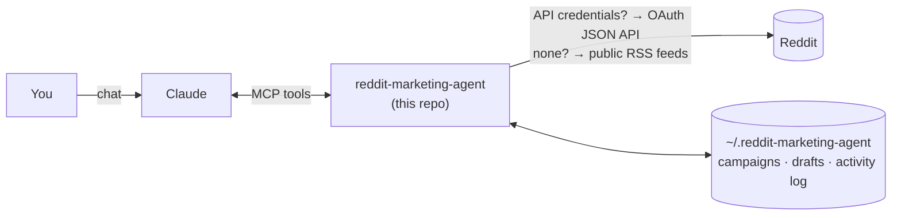

# Reddit Marketing Agent

**Turn Claude into a careful Reddit marketer.** It finds the communities your audience lives in,
spots conversations where your product genuinely helps, drafts replies worth upvoting, and
publishes only what you approve. Guardrails keep you clear of the things that get accounts and
domains banned.

It's an [MCP](https://modelcontextprotocol.io) server, so you control it from **Claude Code**,
**Claude Desktop**, or any MCP client, in plain language:

> *"Find threads this week where freelancers are asking for invoicing tools, and draft replies for the best three."*


---

## What it does

| | |
|---|---|
| 🔎 **Discover communities** | Search subreddits, read their rules, and classify how each one treats self-promotion (banned / restricted / unclear). |
| 📈 **Learn what works** | Best posting hours and days, text vs link share, question-title share, common flairs, and typical scores from each subreddit's top posts. |
| 🎯 **Find opportunities** | Ranks recent threads 0-100 by buying intent ("looking for", "alternative to", "what do you use"), keyword and competitor relevance, freshness, and visibility, with the reasons and cautions spelled out. |
| 👂 **Track mentions** | Watches for your brand or domain (and optionally competitors) and only reports what's new since last time. |
| ✍️ **Draft and review** | Replies and posts go into a local review queue with automatic checks: disclosure, subreddit rules, spam signals, duplicates, locked threads. |
| ✅ **Publish with approval** | Nothing is posted until you approve the exact text. Daily caps, pacing and per-subreddit cooldowns are enforced. |
| 📊 **Measure** | Scores, replies and removals per subreddit, plus your inbox, so you can keep conversations going. |

### The guardrails (why this won't get you banned)

Reddit punishes undisclosed promotion, link spam and copy-paste posting. The agent **blocks**:

- Product mentions without an affiliation disclosure ("I built this", "full disclosure: I work on X")
- Promotion in subreddits whose rules ban it
- Link shorteners, duplicate text, replies to locked or archived threads
- Exceeding the daily action cap, posting too fast, or promoting in the same subreddit within the cooldown

It **warns** about restricted-promo subreddits, too many links, low-effort replies, hype-y titles,
and a promotional share above 10% (the classic 9:1 rule). Publishing is **off by default** and
always needs a final `confirm=true` that Claude is instructed to send only after you approve.

## How it works



Two connection modes, picked automatically:

| Mode | Needs | You get |
|---|---|---|
| `rss` | nothing | Read-only research from Reddit's public RSS feeds: search, browse, threads, subreddit search. No scores or rules, and a strict rate limit (the agent paces itself). Drafts work: post them by hand and log the link. |
| `oauth-app` | Reddit API app (client id + secret) | Full read access: scores, comment counts, rules, subreddit stats, live performance metrics. |
| `oauth-user` | app + Reddit login | Everything above, plus publishing, inbox and account health. |

## Install

You need [uv](https://docs.astral.sh/uv/getting-started/installation/) (`curl -LsSf https://astral.sh/uv/install.sh | sh`).

### Claude Code: as a plugin (tools + playbook skill)

```text
/plugin marketplace add whyujjwal/reddit-marketing-agent
/plugin install reddit-marketing@reddit-marketing-agent
```

### Claude Code: MCP server only

```bash
claude mcp add reddit-marketing -s user -- uvx --managed-python --from git+https://github.com/whyujjwal/reddit-marketing-agent reddit-marketing-agent
```

### Claude Desktop

Add this to `claude_desktop_config.json` (Settings → Developer → Edit Config), then restart Claude:

```json
{
  "mcpServers": {
    "reddit-marketing": {
      "command": "uvx",
      "args": ["--managed-python", "--from", "git+https://github.com/whyujjwal/reddit-marketing-agent", "reddit-marketing-agent"]
    }
  }
}
```

If Claude Desktop can't find `uvx`, use its full path (run `which uvx`).

`--managed-python` makes uv use its own native Python build. Without it, an active Conda or
Intel (x86_64) Python on an Apple Silicon Mac can be picked instead, and installing
`cryptography` (a dependency of the MCP SDK) then fails.

### From source

```bash
git clone https://github.com/whyujjwal/reddit-marketing-agent
cd reddit-marketing-agent
uv sync
uv run reddit-marketing-agent doctor
```

Opening the cloned folder in Claude Code picks up the bundled `.mcp.json` automatically.

## Configure

It works with zero configuration in `rss` mode. To unlock more, create a config file:

```bash
uvx --managed-python --from git+https://github.com/whyujjwal/reddit-marketing-agent reddit-marketing-agent init
```

That writes `~/.reddit-marketing-agent/.env` (readable only by you). Fill in what you have:

| Variable | Default | Purpose |
|---|---|---|
| `REDDIT_CLIENT_ID` / `REDDIT_CLIENT_SECRET` | – | Reddit API app credentials → `oauth-app` mode |
| `REDDIT_USERNAME` / `REDDIT_PASSWORD` | – | Login for posting → `oauth-user` mode |
| `REDDIT_REFRESH_TOKEN` | – | Use instead of a password if the account has 2FA |
| `REDDIT_USER_AGENT` | `python:reddit-marketing-agent:v0.1.0 (by /u/<you>)` | Override the user agent |
| `RMA_POSTING_ENABLED` | `false` | Must be `true` before anything can be published |
| `RMA_APPROVAL_MODE` | `chat` | `chat`: approve in Claude. `terminal`: drafts must be approved with `reddit-marketing-agent approve <id>` |
| `RMA_MAX_ACTIONS_PER_DAY` | `5` | Posts + comments per rolling 24h |
| `RMA_MIN_MINUTES_BETWEEN_ACTIONS` | `10` | Minimum gap between publishes |
| `RMA_SUBREDDIT_COOLDOWN_HOURS` | `72` | Minimum gap between promotional items in the same subreddit |
| `RMA_MAX_PROMO_RATIO` | `0.10` | Warn when promotional share of your logged activity exceeds this |
| `RMA_MAX_RATE_WAIT` | `45` | Longest the agent will wait on a Reddit rate limit within one call |
| `RMA_DATA_DIR` | `~/.reddit-marketing-agent` | Where the config and SQLite database live |

Run `reddit-marketing-agent doctor` to check the setup.

### Getting Reddit API access

As of 2026 Reddit requires approval for new API apps under its Responsible Builder Policy;
creating an app at [reddit.com/prefs/apps](https://www.reddit.com/prefs/apps) is no longer enough
on its own. Request access through Reddit's developer support, describing the use case (personal
community engagement, low volume, human-approved posting). Once approved, create a **script** app
and put its id and secret in the config. Until then, `rss` mode covers research and drafting.

Reddit's [Data API Terms](https://www.redditinc.com/policies/data-api-terms) and each
subreddit's rules apply to you, not to this tool. Read them.

## Use it

Just talk to Claude. A typical first session:

1. *"Check the reddit status."*
2. *"Set up a campaign for my product: an invoicing app for freelancers at invoicely.example.com. I'm the founder."*
   Claude interviews you, finds candidate subreddits, checks their promo rules, and calls `save_campaign`.
3. *"Find today's best opportunities and draft replies for the top three."*
4. Claude shows each draft verbatim with the thread, why it fits, and the check results.
   *"Publish #2, change #1 to not mention the product, drop #3."*
5. *"How did this week go?"*

Built-in prompts (slash commands in Claude Code, prompt picker in Claude Desktop): **Set up a
campaign**, **Daily scout**, **Weekly report**. The plugin also installs the
[`reddit-marketing` skill](skills/reddit-marketing/SKILL.md), a playbook Claude follows for
choosing threads and writing replies. Every client can read it as the MCP resource
`reddit-marketing://playbook`.

### Tools

| Tool | What it does |
|---|---|
| `reddit_status` | Mode, capabilities, limits and usage, account karma/age |
| `find_subreddits` | Discover communities for a topic |
| `subreddit_profile` | Description, size, rules, self-promotion policy |
| `subreddit_insights` | Best times, formats, flairs and typical scores |
| `browse_subreddit` | Hot / new / top / rising posts |
| `search_reddit` | Full Reddit search syntax, multi-subreddit (`SaaS+startups`) |
| `read_thread` | A post plus its comments |
| `find_opportunities` | Ranked threads worth replying to, with reasons and cautions |
| `track_mentions` | New posts mentioning your brand, domain or competitors |
| `save_campaign` / `list_campaigns` | Product context: keywords, competitors, subreddits, voice, disclosure |
| `draft_reply` / `draft_post` | Queue a draft and run the checks |
| `list_drafts` / `revise_draft` / `discard_draft` | Manage the queue |
| `publish_draft` | Preview, then publish with `confirm=true` after your approval |
| `log_manual_post` | Record something you posted by hand |
| `performance_report` | Scores, replies, removals by subreddit |
| `check_inbox` | Replies and messages to follow up on |

### Terminal commands

```bash
reddit-marketing-agent doctor          # check config + connectivity
reddit-marketing-agent drafts          # list pending drafts
reddit-marketing-agent approve 12      # approve draft #12 (for RMA_APPROVAL_MODE=terminal)
reddit-marketing-agent discard 12
```

## Development

```bash
uv sync
uv run pytest            # 50 tests, no network needed
uv run ruff check . && uv run ruff format --check .
```

Layout:

```
src/reddit_marketing_agent/
  server.py       MCP tools, prompts, playbook resource
  service.py      core logic (campaigns, opportunities, drafts, publishing, reports)
  scoring.py      opportunity scoring heuristics
  guardrails.py   promo-policy detection, draft checks, pacing limits
  store.py        SQLite: campaigns, drafts, activity log, seen mentions
  reddit/         OAuth JSON backend, RSS backend, shared polite HTTP session
skills/reddit-marketing/SKILL.md   the playbook (plugin skill + MCP resource)
.claude-plugin/                    Claude Code plugin + marketplace manifests
```

PRs welcome, especially better opportunity heuristics, more promo-rule patterns, and support for
other platforms.

## Built on open source

- [MCP Python SDK](https://github.com/modelcontextprotocol/python-sdk) (MIT): the server framework
- [httpx](https://github.com/encode/httpx) (BSD): HTTP client
- [defusedxml](https://github.com/tiran/defusedxml) (PSF): safe feed parsing
- [python-dotenv](https://github.com/theskumar/python-dotenv) (BSD): config files
- Prior art worth a look: [Hawstein/mcp-server-reddit](https://github.com/Hawstein/mcp-server-reddit) and
  [Arindam200/reddit-mcp](https://github.com/Arindam200/reddit-mcp) (both MIT) for Reddit read
  access over MCP, and [PRAW](https://github.com/praw-dev/praw) (BSD-2), the standard Python
  Reddit API wrapper. This project adds the marketing workflow, scoring and guardrails on top
  of Reddit's own API rather than reusing their code.

## Disclaimer

Not affiliated with or endorsed by Reddit. You are responsible for how you use it: follow
Reddit's User Agreement, its API terms, and every community's rules. The guardrails reduce risk;
they don't replace your judgment.

## License

[MIT](LICENSE)
